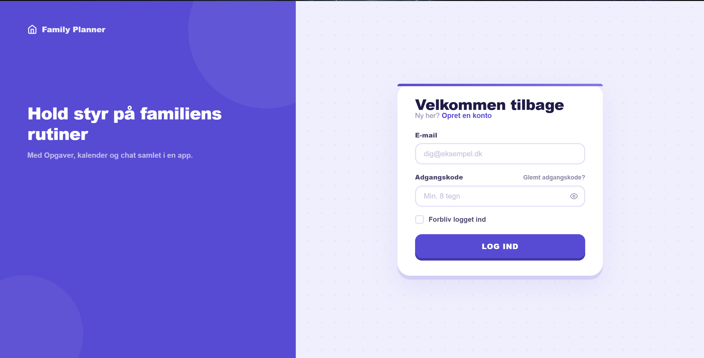
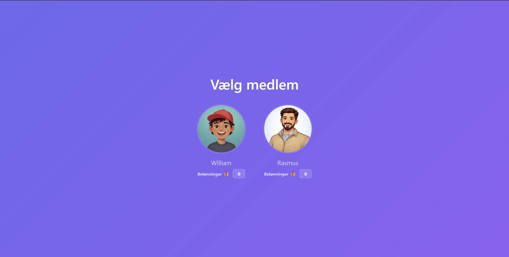
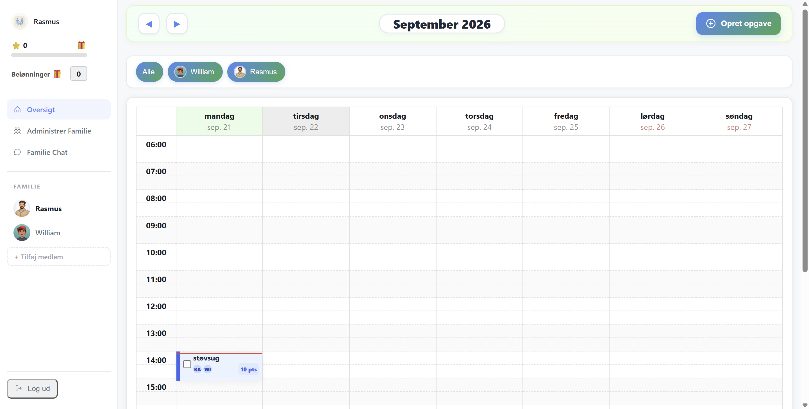
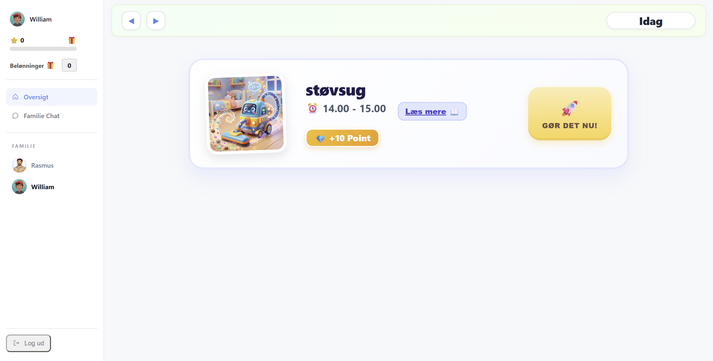

# Family Planner

A family calendar and chore planner: parents plan tasks and award points, children see their tasks and
rewards, and the family can chat. Angular SPA/PWA, Spring Boot API, PostgreSQL.

Built in the DTU full stack course and continued in **62582 Complex Systems and DevOps** (autumn 2026).

## Screenshots a

**Family login** — one account per household.



**Member selection** — after signing in, the family picks who is using the app. Each member has an
avatar and a reward balance.



**Parent view** — the weekly calendar with tasks, a filter per family member, task creation, family
administration and the family chat.



**Child view** — the same data reduced to what is due today: the task, the time, the points on offer,
and one button.



## Architecture

Production (`docker-compose.prod.yml`, see [CI/CD and deployment](#cicd-and-deployment)). In development, `ng serve` takes the place of nginx.

```text
browser ──HTTPS──> nginx (frontend container)
                    ├── /            Angular SPA (static files, index.html fallback)
                    ├── /api/        ──> backend:8080  Spring Boot REST API
                    └── /websocket   ──> backend:8080  STOMP over WebSocket (chat)
                                              │
                                              └──> postgres:5432  PostgreSQL 17
```

| Part | Tech | Folder |
|---|---|---|
| Frontend | Angular 21 (standalone components), Angular Material, angular-calendar, STOMP client, service worker (production builds only) | `frontend/` |
| Backend | Spring Boot 3.5, Java 25, Maven wrapper, Spring Security (stateless JWT + refresh-token cookie), Spring Data JPA, STOMP broker on `/topic` | `backend/` |
| Database | PostgreSQL 17 | container `postgres` |
| E2E tests | Playwright | `e2e/` |
| CI/CD | GitHub Actions, images on GHCR | `.github/workflows/` |

### Code layout

```text
backend/src/main/java/backend/
├── family/      family account: register, login, refresh
├── user/        family members (parent/child), PIN, points
├── task/        tasks and calendar events
├── message/     chat messages (REST + WebSocket)
├── image/       image upload and download
└── common/
    ├── config/      Spring Security, CORS, WebSocket
    ├── security/    JWT filter/util, WebSocket auth, refresh tokens
    └── exception/   global exception handler
backend/src/test/java/backend/   unit tests (*Test) and Testcontainers integration tests (*IT)

frontend/src/app/
├── auth/        AuthService, HTTP interceptor, route guard
├── components/  pages and UI components
├── features/    task feature
└── services/    HTTP services, WebSocket service, signal-based PointsStore
```

## Prerequisites

- Git
- Docker Desktop (Windows/macOS) or Docker Engine with the Compose plugin (Linux)
- Only for running or testing outside Docker: JDK 25 and Node.js 22 or 24

Commands below are shown for bash (Linux, macOS, Git Bash). Where Windows differs, the PowerShell version
is given too.

## Run locally (Docker, recommended)

```bash
git clone https://github.com/LuskeRuby/Devops.git
cd Devops
docker compose up
```

Compose loads `docker-compose.yml` and `docker-compose.override.yml` (dev) automatically. The project name
is fixed to `family-planner`, whatever the folder is called.

| Service | URL | Notes |
|---|---|---|
| frontend | http://localhost:4200 | `ng serve` with live reload; proxies `/api` and `/websocket` to the backend |
| backend | http://localhost:8080 | `mvn spring-boot:run` on the mounted source |
| postgres | localhost:5432 | database `familyapp`, user `admin`, password `postgres` (dev only) |

The first start takes a few minutes (Maven and npm downloads). The app is ready when the backend logs
`Started BackendApplication`. Create an account at http://localhost:4200/register to log in.

Stop with `Ctrl+C`, or `docker compose down`. Add `-v` to also delete the database volume.

### Seed data (optional)

Start the stack first and wait for the backend: Hibernate creates the tables on startup.

```bash
./seed.sh
```

```powershell
.\seed.bat
```

The schema uses `ddl-auto=create-drop`, so the data is gone after every backend restart; seed again.
The seeded families have no known passwords, so they are for looking at data, not for logging in.

## Run parts on the host (without the app containers)

Start only the database, then run the backend and/or frontend on your machine.

```bash
docker compose up postgres
```

Backend (needs JDK 25). `application.properties` points at the compose host name `postgres`, so override
the URL and password:

```bash
cd backend
SPRING_DATASOURCE_URL=jdbc:postgresql://localhost:5432/familyapp \
SPRING_DATASOURCE_PASSWORD=postgres \
./mvnw spring-boot:run
```

```powershell
cd backend
$env:SPRING_DATASOURCE_URL = "jdbc:postgresql://localhost:5432/familyapp"
$env:SPRING_DATASOURCE_PASSWORD = "postgres"
.\mvnw.cmd spring-boot:run
```

Frontend (needs Node 22 or 24):

```bash
cd frontend
npm ci
npm start
```

`frontend/proxy.conf.mjs` sends `/api` and `/websocket` to `http://localhost:8080` by default. Set
`BACKEND_URL` to use another backend (compose sets it to `http://backend:8080`).

## Tests

Backend (Docker must be running: the tests use Testcontainers PostgreSQL):

```bash
cd backend
./mvnw verify      # unit tests + integration tests; Windows: .\mvnw.cmd verify
```

Frontend (the same steps as CI):

```bash
cd frontend
npm ci
npx ng lint
npx prettier --check "src/**/*.{ts,html,scss}"   # fix with --write
npx ng test --no-watch
npm run build
```

End-to-end (Playwright). Start the dev stack first (`docker compose up`); Playwright reuses the servers on
ports 8080 and 4200 and registers its own test family through the API.

```bash
cd e2e
npm ci
npx playwright install     # first time only: downloads the browsers
npx playwright test
```

## CI/CD and deployment

Workflows are in `.github/workflows/`. `ci-cd.yml` is the entry point for pull requests and pushes to
`main`; it calls `pr.yml`, `main-to-staging.yml` and `staging.yml`. `release.yml` runs on version tags.

```text
feature/* or fix/* ──PR──> main ──push──> images ─> e2e ─> staging branch ─> load tests
                                                                  │
                                  tag vX.Y.Z (on a staging commit) ──> retag images ─> deploy to production
```

| Step | Trigger | Workflow | What happens |
|---|---|---|---|
| 1. Pull request | PR to `main` | `pr.yml` | Backend `./mvnw verify` (unit + integration tests), frontend lint, Prettier, unit tests and production build. Required to merge. |
| 2. Main | push to `main` | `main-to-staging.yml` | Build the backend and frontend images and push them to `ghcr.io/luskeruby/devops-<app>:<commit sha>`. Start exactly those images with `docker-compose.ci.yml` and run the Playwright tests (`e2e/`). If they pass, fast-forward the `staging` branch to the commit (`git push origin HEAD:staging` with `GITHUB_TOKEN`). One promotion runs at a time (`concurrency`); if `staging` already contains the commit, the step does nothing. |
| 3. Staging | after step 2 | `staging.yml` | Load tests. Only a stub for now. |
| 4. Release | push of a tag `vX.Y.Z` | `release.yml` | Check that the tag is a plain `vX.Y.Z` and that its commit is on `staging`. Add the version as a tag to the existing `:<sha>` images (`docker buildx imagetools create`, no rebuild). Deploy with `environment: production`. |

Nothing is rebuilt after step 2: the image that passed the e2e tests is the image that is released.

### Releasing

A release tag is created by a person, not by a workflow (the tag rulesets in `.github/rulesets/` limit
who can create, move and delete `v*` tags, and `GITHUB_TOKEN` is never used to create tags). Pick a
commit that is on `staging`:

```bash
git fetch origin
git tag v1.2.3 origin/staging      # or any older commit that is on staging
git push origin v1.2.3
```

If the `production` environment requires reviewers, the deploy job waits for their approval.

### Production

Production runs on one server (`docker-compose.prod.yml`: `frontend` (nginx), `backend`, `postgres`). The
images come from GHCR and are selected by the `TAG` variable (the release version); nothing is built on
the server.

nginx serves the SPA on ports 80/443, redirects HTTP to HTTPS, terminates TLS with the certificate in
`./certs` (not in git), and proxies `/api/` and `/websocket` to the backend. PostgreSQL is only reachable
from the other containers.

The deploy job copies the compose file to `~/family-planner` on the server, writes a private `.env`
(mode 600), logs in to `ghcr.io` with the job's token and runs:

```bash
docker compose -f docker-compose.prod.yml --env-file .env pull
docker compose -f docker-compose.prod.yml --env-file .env up -d --remove-orphans
```

The server needs Docker with the Compose plugin and an SSH user that may run it.

### Repository setup

The images carry `org.opencontainers.image.source`, which links the GHCR packages to this repository so
`GITHUB_TOKEN` can push and pull them. The branch and tag rulesets are in `.github/rulesets/` (import
them under Settings, Rules): `main` needs a reviewed PR with the two `pr` checks, `staging` cannot be
deleted or rewritten, and `v*` tags can only be created, moved or deleted by the listed users. The
deploy reads these secrets (repository or `production` environment secrets):

| Secret | Used for |
|---|---|
| `SSH_USER`, `SSH_PRIVATE_KEY` | SSH login on the server |
| `SSH_HOST` | Address of the server |
| `PROD_DB_USER`, `PROD_DB_PASSWORD` | Database user, used by `postgres` and the backend. Do not use a `'` in the password: the `.env` file written by the deploy cannot hold one. |
| `SSL_CERTIFICATE`, `SSL_PRIVATE_KEY` | TLS certificate and key, written to `certs/cert.pem` and `certs/key.pem` |

Known gaps: the deploy trusts the server's SSH host key on first use (`ssh-keyscan`) instead of a pinned
key; the load test is a stub; and there is no automatic rollback (to go back, tag and release an older
staging commit). A second server with several backends and a message broker is planned. Until then the
backend keeps Spring's in-memory STOMP broker, so it must stay a single instance.

## Line endings

`.gitattributes` makes every text file LF on all platforms (`.bat`/`.cmd` stay CRLF), so Linux tools,
Docker bind mounts and Prettier agree with Windows. A fresh clone needs nothing. A clone made before this
change still has CRLF files on Windows; to refresh it, commit or stash your work and then run:

```bash
git rm -r --cached -q .
git reset --hard
```
