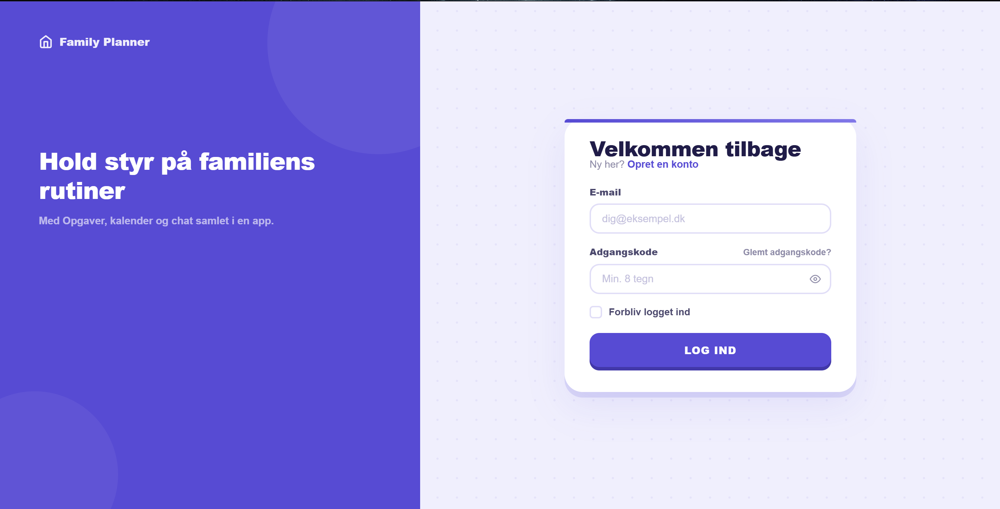
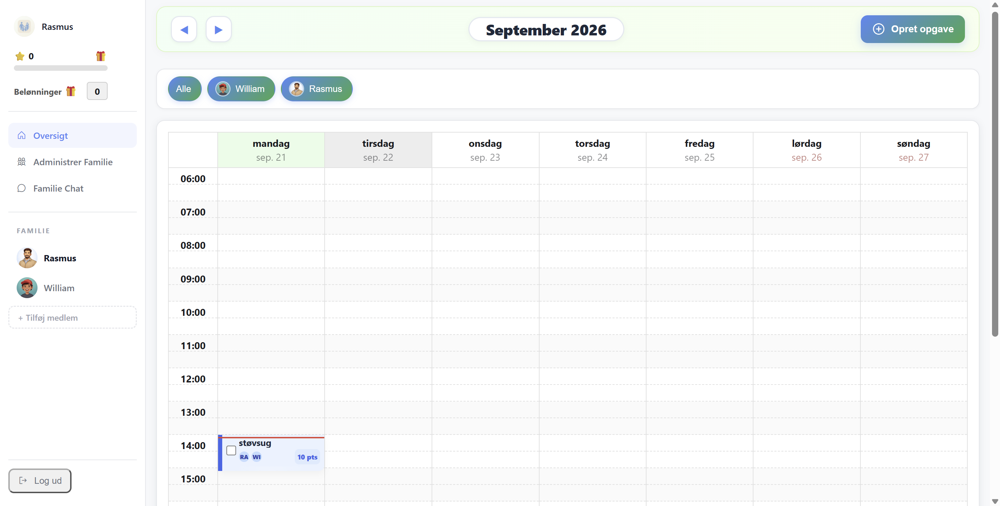
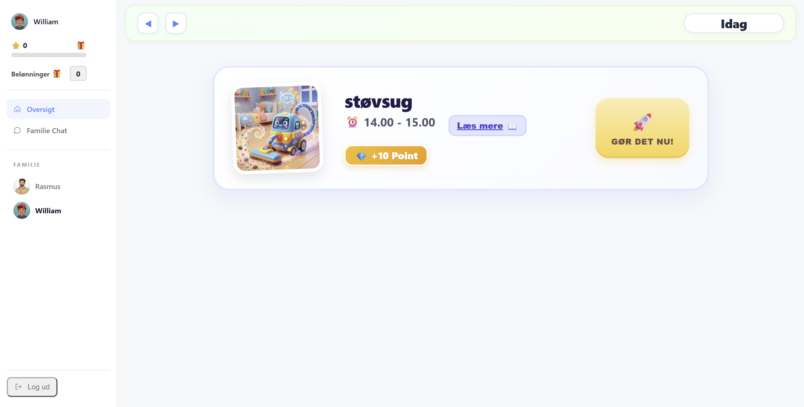

# Family Planner

A family calendar and chore planner: parents plan tasks and award points, children see their tasks and
rewards, and the family can chat. Angular SPA/PWA, Spring Boot API, PostgreSQL.

Built in the DTU full stack course and continued in **62582 Complex Systems and DevOps** (autumn 2026).

## Screenshots a

**Family login** — one account per household.



**Member selection** — after signing in, the family picks who is using the app. Each member has an
avatar and a reward balance.


**Parent view** — the weekly calendar with tasks, a filter per family member, task creation, family
administration and the family chat.



**Child view** — the same data reduced to what is due today: the task, the time, the points on offer,
and one button.



## Architecture

Production runs on two servers joined by a WireGuard tunnel (see [CI/CD and deployment](#cicd-and-deployment)). In development, `ng serve` takes the place of nginx.

```text
browser ──HTTPS──> Server B: nginx (frontend container)
                    ├── /            Angular SPA (static files, index.html fallback)
                    ├── /api/        ──WireGuard──> Server A: backend-1 .. backend-N, ports 8080 ..
                    └── /websocket   ──WireGuard──> Server A: (round robin)  REST API and STOMP chat
                                                          │
                    Server B: postgres:5432  <──WireGuard─┤  (JDBC)
                    Server B: rabbitmq:61613 <──WireGuard─┘  (STOMP relay: chat messages)
```

Chat messages are saved in PostgreSQL and then published through RabbitMQ (Spring's STOMP broker relay),
so every backend instance shares one broker and all browsers see all messages. In development and in the
tests the backend uses Spring's in-memory broker instead (`APP_BROKER_MODE=simple`, the default).

| Part | Tech | Folder |
|---|---|---|
| Frontend | Angular 21 (standalone components), Angular Material, angular-calendar, STOMP client, service worker (production builds only) | `frontend/` |
| Backend | Spring Boot 4.1, Java 25, Maven wrapper, Spring Security (stateless JWT + refresh-token cookie), Spring Data JPA, STOMP broker on `/topic` | `backend/` |
| Database | PostgreSQL 17 | container `postgres` |
| E2E tests | Playwright | `e2e/` |
| CI/CD | GitHub Actions, images on GHCR | `.github/workflows/` |

### Code layout

```text
backend/src/main/java/backend/
├── family/      family account: register, login, refresh
├── user/        family members (parent/child), PIN, points
├── task/        tasks and calendar events
├── message/     chat messages (REST + WebSocket)
├── image/       image upload and download
└── common/
    ├── config/      Spring Security, CORS, WebSocket
    ├── security/    JWT filter/util, WebSocket auth, refresh tokens
    └── exception/   global exception handler
backend/src/test/java/backend/   unit tests (*Test) and Testcontainers integration tests (*IT)

frontend/src/app/
├── auth/        AuthService, HTTP interceptor, route guard
├── components/  pages and UI components
├── features/    task feature
└── services/    HTTP services, WebSocket service, signal-based PointsStore
```

## Prerequisites

- Git
- Docker Desktop (Windows/macOS) or Docker Engine with the Compose plugin (Linux)
- Only for running or testing outside Docker: JDK 25 and Node.js 22 or 24

Commands below are shown for bash (Linux, macOS, Git Bash). Where Windows differs, the PowerShell version
is given too.

## Run locally (Docker, recommended)

```bash
git clone https://github.com/LuskeRuby/Devops.git
cd Devops
docker compose up
```

Compose loads `docker-compose.yml` and `docker-compose.override.yml` (dev) automatically. PostgreSQL is defined in
`infra/postgres/docker-compose.yml` and included from the root file.

| Service | URL | Notes |
|---|---|---|
| frontend | http://localhost:4200 | `ng serve` with live reload; proxies `/api` and `/websocket` to the backend |
| backend | http://localhost:8080 | `mvn spring-boot:run` on the mounted source |
| postgres | localhost:5432 | database `familyapp`, user `admin`, password `postgres` (dev only) |

The first start takes a few minutes (Maven and npm downloads). The app is ready when the backend logs
`Started BackendApplication`. Create an account at http://localhost:4200/register to log in.

Stop with `Ctrl+C`, or `docker compose down`. Add `-v` to also delete the database volume.

### Seed data (optional)

Start the stack first and wait for the backend: Flyway creates the tables on startup.

```bash
./scripts/seed/seed.sh
```

Flyway (`backend/src/main/resources/db/migration`) owns the schema, so data now survives backend restarts and
`docker compose down`. Seeding twice fails on duplicate keys; `docker compose down -v` wipes the database.

> **Upgrading an existing checkout:** if your dev database was created by the old `create-drop` setup,
> Flyway refuses to start on it. Run `docker compose down -v` once, then `docker compose up`.
The seeded families have no known passwords, so they are for looking at data, not for logging in.

## Run parts on the host (without the app containers)

Start only the database, then run the backend and/or frontend on your machine.

```bash
docker compose up postgres
```

Backend (needs JDK 25). `application.properties` points at the compose host name `postgres`, so override

```bash
cd backend
SPRING_DATASOURCE_URL=jdbc:postgresql://localhost:5432/familyapp \
SPRING_DATASOURCE_PASSWORD=postgres \
./mvnw spring-boot:run
```

```powershell
cd backend
$env:SPRING_DATASOURCE_URL = "jdbc:postgresql://localhost:5432/familyapp"
$env:SPRING_DATASOURCE_PASSWORD = "postgres"
.\mvnw.cmd spring-boot:run
```

Frontend (needs Node 22 or 24):

```bash
cd frontend
npm ci
npm start
```

`frontend/proxy.conf.mjs` sends `/api` and `/websocket` to `http://localhost:8080` by default. Set
`BACKEND_URL` to use another backend (compose sets it to `http://backend:8080`).

## Tests

Backend (Docker must be running: the tests use Testcontainers PostgreSQL):

```bash
cd backend
./mvnw verify      # unit tests + integration tests; Windows: .\mvnw.cmd verify
```

Frontend (the same steps as CI):

```bash
cd frontend
npm ci
npx ng lint
npx prettier --check "src/**/*.{ts,html,scss}"   # fix with --write
npx ng test --no-watch
npm run build
```

End-to-end (Playwright). Start the dev stack first (`docker compose up`); Playwright reuses the servers on
ports 8080 and 4200 and registers its own test family through the API.

```bash
cd e2e
npm ci
npx playwright install     # first time only: downloads the browsers
npx playwright test
```

## CI/CD and deployment

Workflows are in `.github/workflows/`. `ci-cd.yml` is the entry point for pull requests and pushes to
`main`; it calls `pr.yml`, `main-to-staging.yml` and `staging.yml`. `release.yml` runs on version tags.

```text
feature/* or fix/* ──PR──> main ──push──> images ─> e2e ─> staging branch ─> load tests
                                                                  │
                                  tag vX.Y.Z (on a staging commit) ──> retag images ─> deploy to production
```

| Step | Trigger | Workflow | What happens |
|---|---|---|---|
| 1. Pull request | PR to `main` | `pr.yml` | Backend `./mvnw verify` (unit + integration tests), frontend lint, Prettier, unit tests and production build. Required to merge. |
| 2. Main | push to `main` | `main-to-staging.yml` | Build the backend and frontend images and push them to `ghcr.io/luskeruby/devops-<app>:<commit sha>`. Start exactly those images with `docker-compose.ci.yml` and run the Playwright tests (`e2e/`). If they pass, fast-forward the `staging` branch to the commit (`git push origin HEAD:staging` with `GITHUB_TOKEN`). One promotion runs at a time (`concurrency`); if `staging` already contains the commit, the step does nothing. |
| 3. Staging | after step 2 | `staging.yml` | Load tests. Only a stub for now. |
| 4. Release | push of a tag `vX.Y.Z` | `release.yml` | Check that the tag is a plain `vX.Y.Z` and that its commit is on `staging`. Add the version as a tag to the existing `:<sha>` images (`docker buildx imagetools create`, no rebuild). Deploy to both production servers with `environment: production`. |

Nothing is rebuilt after step 2: the image that passed the e2e tests is the image that is released.

### Releasing

A release tag is created by a person, not by a workflow (the tag rulesets in `.github/rulesets/` limit
who can create, move and delete `v*` tags, and `GITHUB_TOKEN` is never used to create tags). Pick a
commit that is on `staging`:

```bash
git fetch origin
git tag v1.2.3 origin/staging      # or any older commit that is on staging
git push origin v1.2.3
```

If the `production` environment requires reviewers, the deploy job waits for their approval.

### Production

Production runs on two servers joined by a WireGuard tunnel:

| Server | Runs | Compose file |
|---|---|---|
| B (frontend) | `frontend` (nginx) on ports 80/443, `postgres` (defined in `infra/postgres/`) and `rabbitmq` (the message broker, `infra/rabbitmq/`) | `docker-compose.prod-frontend.yml` |
| A (backend) | `BACKEND_COUNT` backend instances (`backend-1` on port 8080, `backend-2` on 8081, ...; 1 to 4), published only on Server A's WireGuard address; chat goes through RabbitMQ on Server B | `docker-compose.prod-backend.yml` |

**Several backends.** The repository variable `BACKEND_COUNT` (1 to 4, default 1) says how many instances of the
backend image run on Server A: instance N is `backend-N` on port 8079+N. nginx spreads requests over all of
them (round robin) and stops using one that fails three times in a row; a request that hits a backend that is
down or answers 502/503 is retried on another one (POST is not repeated once it was sent). Chat works across
the instances because they all publish through RabbitMQ, and each browser reconnects and reloads the history
if its backend goes away. To change the number, set `BACKEND_COUNT` and release: raising it adds instances and
nginx upstream lines, lowering it stops and removes the extra instances. More than one needs the RabbitMQ relay
(the production default). A fifth instance needs one more `backend-N` block in
`docker-compose.prod-backend.yml`, `MAX_BACKENDS` in `release.yml` and the port list in the `pr.yml` check
(which fails if they disagree). All instances share Server A: this spreads load and survives a crashed or
restarting backend, not the loss of the server.

The images come from GHCR and are selected by the `TAG` variable (the release version); nothing is built on
the servers.

nginx serves the SPA on ports 80/443, redirects HTTP to HTTPS, terminates TLS with the certificate in
`./certs` (not in git), and proxies `/api/` and `/websocket` to the backend on Server A through the tunnel.
Its config is `frontend/nginx.conf.template`; the container fills in `IP_FRONTEND_PUBLIC`,
`BACKEND_SERVERS` (the `server` lines of the upstream, built from `BACKEND_COUNT` by
`.github/scripts/backend-servers.sh`) when it starts. PostgreSQL is published only on Server B's WireGuard address, and
`infra/postgres/pg_hba.prod.conf` accepts only the backend's address, with a password. Flyway creates and
migrates the schema when the backend starts, so the data survives releases.

The deploy job (`release.yml`) works in this order:

0. **Before anything is pulled:** checks that the production variables are set, that
   `infra/postgres/pg_hba.prod.conf` allows `IP_BACKEND_WG` (that file cannot read variables), and that both
   servers have enough free disk space (5 GB on Server B, 3 GB on Server A; `check-disk.sh`). A full disk once
   crashed RabbitMQ in the middle of a release.
1. **Server B:** copies `docker-compose.prod-frontend.yml`, `infra/postgres/` and the certificates, writes a
   private `.env` (mode 600), logs in to `ghcr.io` with the job's token, pulls the images and starts `postgres`
   and `rabbitmq`, waiting until both are healthy (`--wait`, 2 minutes) before going on. Prometheus and Loki
   start here too, so they are up before Server A starts sending to them.
2. **Server A, one backend at a time (rolling):** copies `docker-compose.prod-backend.yml`, writes its `.env`,
   pulls the image and replaces `backend-1`. `.github/scripts/check-backend.sh` then calls it on its own port
   and waits for its log to show the connection to RabbitMQ (a wrong broker login or a closed tunnel leaves a
   backend up but chat dead). Only then is the next instance replaced and checked the same way, so the others
   keep serving the old version during the release. Instances above `BACKEND_COUNT` are removed. The deploy
   stops at the first failing check. Because versions overlap, a database migration must work for the old
   and the new version (add first, remove in a later release).
3. **Server B:** starts the frontend and the rest of the monitoring (nginx picks up the upstream). A final check
   goes through nginx to the backend; it cannot tell the instances apart, which is why the checks in step 2
   call each port directly.
4. **Clean-up:** removes this project's release images that no container uses and that are over a week old, on
   both servers (only images with this repository's source label; a failure here does not fail the release).

On a server, the equivalent commands are (Server A shown). **Always list both compose files**: the monitoring
file is part of the same compose project, and `--remove-orphans` (or a command that leaves it out) treats the
monitoring containers as strangers and removes them.

```bash
COMPOSE="docker compose --profile scale -f docker-compose.prod-backend.yml -f docker-compose.prod-backend-monitoring.yml --env-file .env"
$COMPOSE pull
$COMPOSE up -d backend-1 backend-2
```

Name the instances you want: a bare `up -d` starts only `backend-1` (plus the monitoring), because `backend-2`
to `backend-4` are in the `scale` profile. Server B is the same with `docker-compose.prod-frontend.yml` and
`docker-compose.prod-frontend-monitoring.yml`.

Both servers need Docker with the Compose plugin and an SSH user that may run it, the deploy public key in
that user's `authorized_keys`, port 22 reachable from GitHub, and the WireGuard tunnel up before Docker
starts (the backend, Postgres and RabbitMQ publish ports on the tunnel addresses).

#### Monitoring and disk space

| Server | Runs | Reachable from |
|---|---|---|
| B | Prometheus (metrics, 7 days, at most 2 GB), Loki (logs, 7 days), Grafana, Alloy, node-exporter, nginx-exporter | Prometheus (`9090`) and Loki (`3100`) on Server B's WireGuard address, for Server A. Grafana only on `127.0.0.1:3000`. |
| A | Alloy (ships Server A's logs and the backends' metrics to Server B), node-exporter | nothing is published |

Open Grafana through an SSH tunnel and log in as `admin` with the `GRAFANA_ADMIN_PASSWORD` secret (it only
takes effect on Grafana's first start; change it later in Grafana):

```bash
ssh -L 3000:127.0.0.1:3000 <user>@<Server B>
```

then browse to `http://localhost:3000`. The backends expose their metrics on the management port 8081 *inside*
their container (not published, and not the same as backend-2's published port 8081); Alloy scrapes them there.

Disk space matters on Server B (about 19 GB in total at the time of writing, and it runs Postgres, RabbitMQ,
nginx and the monitoring). Several things keep it from filling up again: every production container's log is
capped at 3 × 10 MB (a CI check fails if a service has no cap), Prometheus is limited by size as well as by
age, the release stops early if a server is nearly full, and old release images are removed after a release.
Loki has no size limit, only the 7 days. If space runs out anyway: `docker builder prune`, `docker image prune -a`
and `sudo journalctl --vacuum-size=200M` are safe; **never** `docker volume prune` or `docker system prune
--volumes` (Postgres' data lives in a volume). Capping the system journal permanently (`SystemMaxUse=200M` in
`/etc/systemd/journald.conf`) is a setting on the server itself, not in this repository.

#### Cutover from the single-server setup (one time)

Before this setup, one server ran `frontend`, `backend` and `postgres` in the compose project `family-planner`
(containers `family-planner-frontend-1`, `family-planner-backend-1`, `family-planner-postgres-1`). That stack
is **not** removed by the new deploy: it is a different compose project, so it keeps running on Server A,
serves the old address with its own database, and the new Postgres on Server B starts empty.

1. **Before the first release:**
   - The `production` variables and secrets are set, the deploy key is in `authorized_keys` on both
     servers, and the WireGuard tunnel is up on both (`sudo wg show` shows a recent handshake).
   - The TLS certificate (`SSL_CERTIFICATE`, `SSL_PRIVATE_KEY`) covers Server B's public address; browsers
     warn otherwise.
   - Optional, if the old data matters, dump it on Server A:
     `docker exec family-planner-postgres-1 sh -c 'pg_dump -U "$POSTGRES_USER" -d familyapp -Fc' > ~/old-familyapp.dump`
2. **Release.** The new backend runs on Server A next to the old stack (it publishes only on the tunnel
   address, so ports do not clash). The new site is served from Server B's address.
3. **Check the new site** on Server B: register, log in, send a chat message.
4. **Retire the old stack** on Server A. Never use `down -v`; the old database volume stays as a rollback copy:

   ```bash
   docker stop family-planner-frontend-1 family-planner-backend-1 family-planner-postgres-1
   ```

   To roll back to it, `docker start` the same three containers. Note that the deploy rewrites
   `~/family-planner/.env` on Server A with the new variables.
5. **Clean up afterwards:** delete the unused `SSH_HOST` secret and `PG_HBA_FILE` variable, remove the old
   `github-actions` key from Server A's `authorized_keys`, and turn off SSH password login on both servers
   once your own key works.

### Repository setup

The images carry `org.opencontainers.image.source`, which links the GHCR packages to this repository so
`GITHUB_TOKEN` can push and pull them. The branch and tag rulesets are in `.github/rulesets/` (import
them under Settings, Rules): `main` needs a reviewed PR with the two `pr` checks, `staging` cannot be
deleted or rewritten, and `v*` tags can only be created, moved or deleted by the listed users. The
deploy reads these secrets and variables (repository or `production` environment):

| Secret | Used for |
|---|---|
| `SSH_USER` | SSH login name on both servers |
| `SSH_PRIVATE_KEY` | Deploy key; its public half is in `authorized_keys` on both servers |
| `PROD_DB_USER`, `PROD_DB_PASSWORD` | Database user, used by `postgres` and the backend. Do not use a `'` in the password: the `.env` file written by the deploy cannot hold one. |
| `RABBITMQ_USER`, `RABBITMQ_PASSWORD` | Login for the message broker on Server B (never `guest`). Same `'` restriction as the database password; the release stops before touching a server if one is missing or contains a `'`. |
| `GRAFANA_ADMIN_PASSWORD` | Grafana's admin password on Server B. Same `'` restriction as the others; the release stops before touching a server if it is missing. |
| `APP_JWT_SECRET` | Signing key for the backend's JWTs (at least 32 characters) |
| `SSL_CERTIFICATE`, `SSL_PRIVATE_KEY` | TLS certificate and key, written to `certs/cert.pem` and `certs/key.pem` |

| Variable | Used for |
|---|---|
| `IP_FRONTEND_PUBLIC` | Server B's public address: SSH target, nginx `server_name`, allowed CORS origin |
| `IP_BACKEND_PUBLIC` | Server A's public address: SSH target |
| `IP_FRONTEND_WG` | Server B's WireGuard address: Postgres and RabbitMQ bind, and the backend's database and broker host |
| `IP_BACKEND_WG` | Server A's WireGuard address: the backends' bind address, and the address in nginx's upstream |
| `BACKEND_COUNT` | Number of backend instances, 1 to 4. Optional, default 1. |

Known gaps: the deploy trusts the servers' SSH host keys on first use (`ssh-keyscan`) instead of pinned
keys; the load test is a stub; and there is no automatic rollback (to go back, tag and release an older
staging commit). RabbitMQ is a single node: if it stops, chat stops until it is back (the backend and the
browsers reconnect by themselves).

## Line endings

`.gitattributes` makes every text file LF on all platforms (`.bat`/`.cmd` stay CRLF), so Linux tools,
Docker bind mounts and Prettier agree with Windows. A fresh clone needs nothing. A clone made before this
change still has CRLF files on Windows; to refresh it, commit or stash your work and then run:

```bash
git rm -r --cached -q .
git reset --hard
```